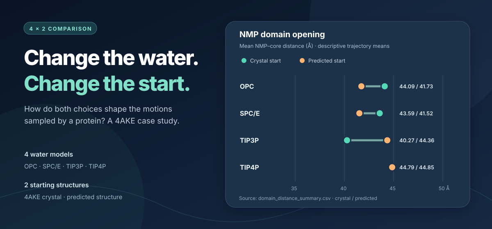
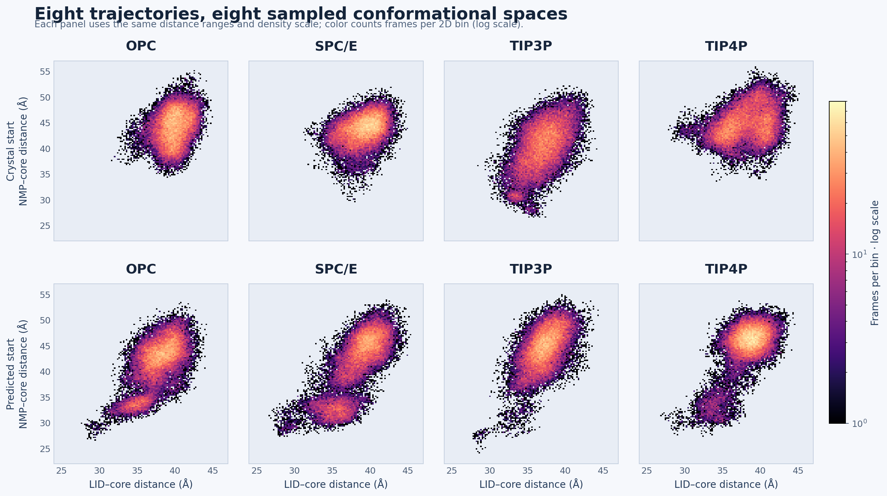

# Water models × starting structures: a protein-motion comparison

**A visual analysis of eight 300 ns molecular-dynamics trajectories of adenylate kinase (4AKE).** Four explicit-water models (OPC, SPC/E, TIP3P and TIP4P) were each run from a crystal-derived and a predicted starting structure. The identity of the predicted structure and the simulation setup still need confirmation.

> **Status:** Figure-led results story. The figures describe these trajectories; they do not yet establish a general ranking of water models. Simulation input files, analysis scripts and independent replicate information are not present in this folder.

**Explore:** [Domain motion](#2-the-solvent-and-starting-structure-jointly-shape-domain-opening) · [Conformational landscapes](#3-the-sampled-conformational-landscapes-differ) · [Hydration context](#4-hydration-and-correlated-motion) · [Evidence and limits](docs/EVIDENCE_AND_LIMITS.md)

## The question

Does changing the water model alter the domain motions sampled by 4AKE, and does that depend on whether the simulation starts from the crystal or predicted structure?

## The visual story

### 1. The starting structure leaves a time-dependent signature

The predicted-start trajectories begin with larger deviations from the open reference in several conditions. The clearest early relaxation is in the NMP domain for OPC and SPC/E. The backbone and domain RMSD traces show why a single whole-trajectory average can hide this behavior.

**Figure 1.** Backbone, LID, NMP and core RMSD relative to the open reference. Columns are water models; green is crystal start and orange is predicted start. Source: [`tables/rmsd_summary.csv`](tables/rmsd_summary.csv) and the underlying time series, which are retained locally but omitted from the compact GitHub package.

### 2. The solvent and starting structure jointly shape domain opening

LID–core and NMP–core distances do not shift in one uniform direction. For example, OPC crystal has a mean NMP–core distance of **44.09 Å** versus **41.73 Å** for OPC predicted; TIP3P reverses that ordering (**40.27 Å** crystal versus **44.36 Å** predicted). The angle distributions tell a similar condition-dependent story.

**Figures 2–3.** Domain distance time series and NMP–core–LID angle distributions. Values and labels: [`domain_distance_summary.csv`](tables/domain_distance_summary.csv), [`domain_angle_summary.csv`](tables/domain_angle_summary.csv). The separation of curves is descriptive evidence from individual trajectories, not a replicate-level uncertainty estimate.

### 3. The sampled conformational landscapes differ

The LID/NMP distance maps put all eight trajectories on the same axes and density scale. The predicted-start runs with OPC, SPC/E and TIP4P visit an additional compact NMP region in these trajectories, while their crystal-start counterparts concentrate elsewhere. These maps count sampled frames; they are **not equilibrium free-energy landscapes**.

**Figure 4.** LID–core versus NMP–core distance occupancy, with identical axis limits, bins and color scale. Recreate it with [`scripts/plot_domain_landscapes.py`](scripts/plot_domain_landscapes.py) using the included [`data/domain_distances.csv`](data/domain_distances.csv) and [`requirements.txt`](requirements.txt). The maps remain sensitive to finite sampling and early relaxation.

An [exploratory Jensen–Shannon divergence heatmap](figures/fig11_jsd_heatmap.png) compares the same coordinates. Its uncertainty analysis needs review before treating model differences as robust. See the [evidence and limits guide](docs/EVIDENCE_AND_LIMITS.md).

### 4. Hydration and correlated motion

Water-bridge counts and domain-motion correlations vary by condition. They provide context for hypotheses about hydration and motion. Their association does not establish that individual waters drive particular conformational changes.

**Figures 5–6.** Mean bridge-water counts and off-diagonal LID/NMP dynamic cross-correlation. Summaries: [`water_bridge_summary.csv`](tables/water_bridge_summary.csv), [`dccm_network_summary.csv`](tables/dccm_network_summary.csv). Definitions and cutoffs must be recovered before manuscript use.

## What this dataset supports

The strongest defensible conclusion is that **the sampled 4AKE domain motions vary across combinations of water model and starting structure**. Differences are visible across distance traces, angle distributions and condition-matched occupancy maps. The available trajectories alone cannot separate a reproducible water-model effect from run-to-run variation or initial-condition memory.

## Repository map

- [`docs/EVIDENCE_AND_LIMITS.md`](docs/EVIDENCE_AND_LIMITS.md): claim-by-claim evidence, figure selection, and known analysis issues.
- [`docs/PREPRINT_DRAFT.md`](docs/PREPRINT_DRAFT.md): provisional title, abstract and manuscript outline.
- [`docs/METHODS_TO_RECOVER.md`](docs/METHODS_TO_RECOVER.md): exact information needed for a reproducible preprint.
- [`figures/`](figures/): selected visual-story panels. The local results folder contains additional exploratory figures.
- [`tables/`](tables/): compact summary tables for the displayed comparisons.
- [`data/domain_distances.csv`](data/domain_distances.csv) and [`scripts/plot_domain_landscapes.py`](scripts/plot_domain_landscapes.py): data and code for the featured occupancy map.

## Publication status

The visual story stands on its own. If we later pursue a preprint, it should wait for the simulation protocol, predicted-structure provenance, trajectory/replicate accounting, and checks of statistical uncertainty and water-diffusion analysis. See the optional [preprint draft](docs/PREPRINT_DRAFT.md) and [methods checklist](docs/METHODS_TO_RECOVER.md).
