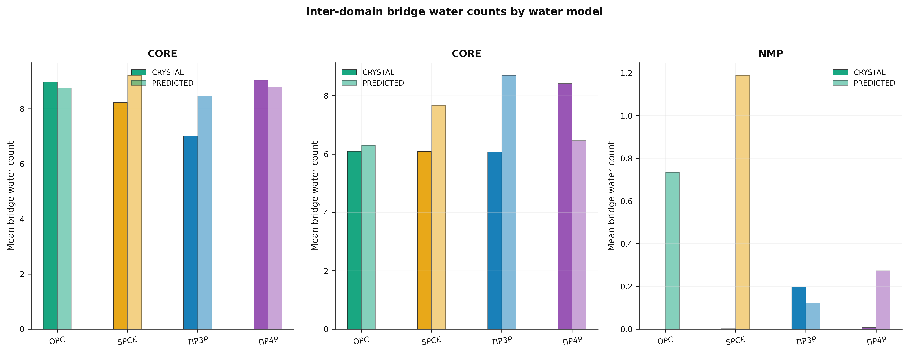
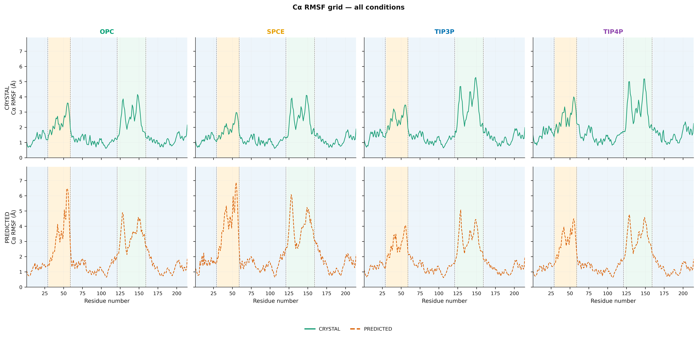
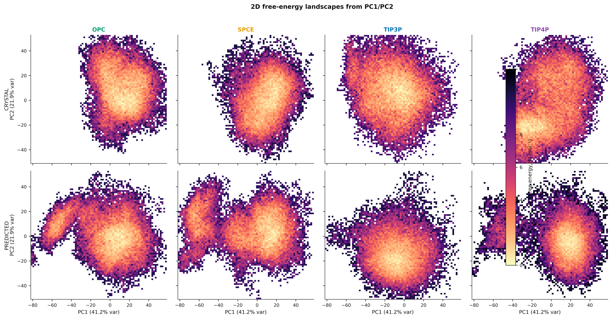
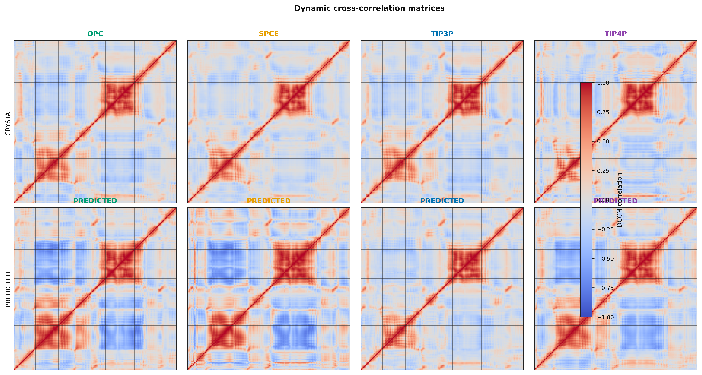

<!-- BANNER PLACEHOLDER: drop your banner at assets/banner.gif (or change the path below) -->

### Water models × Starting Structures: A Protein-Motion Comparison

**A visual analysis of eight 300 ns molecular-dynamics trajectories of adenylate kinase (4AKE).** Four explicit-water models (OPC, SPC/E, TIP3P and TIP4P) were each run from a crystal-derived and a predicted starting structure. The identity of the predicted structure and the simulation setup still need confirmation. The [complete figure atlas](docs/FIGURE_ATLAS.md) covers all **86 historical figures** plus a new reproducible comparison plot.

> **Status:** Figure-led results story and complete visual archive. The figures describe these trajectories; they do not yet establish a general ranking of water models. Simulation input files, original analysis scripts and independent replicate information are not present in this folder.

**Explore:** [Domain motion](#the-solvent-and-starting-structure-jointly-shape-domain-opening) · [Conformational landscapes](#the-sampled-conformational-landscapes-differ) · [Hydration context](#hydration-and-correlated-motion) · [Full figure atlas](docs/FIGURE_ATLAS.md) · [Evidence and limits](docs/EVIDENCE_AND_LIMITS.md)

### The Question

Does changing the water model alter the domain motions sampled by 4AKE, and does that depend on whether the simulation starts from the crystal or predicted structure?

### The Starting Structure Leaves a Time-Dependent Signature

The predicted-start trajectories begin with larger deviations from the open reference in several conditions. The clearest early relaxation is in the NMP domain for OPC and SPC/E. The backbone and domain RMSD traces show why a single whole-trajectory average can hide this behavior.

**Figure 1.** Backbone, LID, NMP and core RMSD relative to the open reference. Columns are water models; green is crystal start and orange is predicted start. Summary: [`tables/rmsd_summary.csv`](tables/rmsd_summary.csv). The underlying time series remain in the original local results archive.

### The Solvent and Starting Structure Jointly Shape Domain Opening

LID–core and NMP–core distances do not shift in one uniform direction. For example, OPC crystal has a mean NMP–core distance of **44.09 Å** versus **41.73 Å** for OPC predicted; TIP3P reverses that ordering (**40.27 Å** crystal versus **44.36 Å** predicted). The angle distributions tell a similar condition-dependent story.

**Figures 2–3.** Domain distance time series and NMP–core–LID angle distributions. Values and labels: [`domain_distance_summary.csv`](tables/domain_distance_summary.csv), [`domain_angle_summary.csv`](tables/domain_angle_summary.csv). The separation of curves is descriptive evidence from individual trajectories, not a replicate-level uncertainty estimate.

### The Sampled Conformational Landscapes Differ

The LID/NMP distance maps put all eight trajectories on the same axes and density scale. The predicted-start runs with OPC, SPC/E and TIP4P visit an additional compact NMP region in these trajectories, while their crystal-start counterparts concentrate elsewhere. These maps count sampled frames; they are **not equilibrium free-energy landscapes**.

**Figure 4.** LID–core versus NMP–core distance occupancy, with identical axis limits, bins and color scale. Recreate it with [`scripts/plot_domain_landscapes.py`](scripts/plot_domain_landscapes.py) using the included [`data/domain_distances.csv`](data/domain_distances.csv) and [`requirements.txt`](requirements.txt). The maps remain sensitive to finite sampling and early relaxation.

An [exploratory Jensen–Shannon divergence heatmap](figures/fig11_jsd_heatmap.png) compares the same coordinates. Its uncertainty analysis needs review before treating model differences as robust. See the [evidence and limits guide](docs/EVIDENCE_AND_LIMITS.md).

### Hydration and Correlated Motion

Water-bridge counts and domain-motion correlations vary by condition. They provide context for hypotheses about hydration and motion. Their association does not establish that individual waters drive particular conformational changes.

**Figures 5–6.** Mean bridge-water counts and off-diagonal LID/NMP dynamic cross-correlation. Summaries: [`water_bridge_summary.csv`](tables/water_bridge_summary.csv), [`dccm_network_summary.csv`](tables/dccm_network_summary.csv). Definitions and cutoffs must be recovered before manuscript use.

### Explore the Other Analyses

The central story uses six figures for a readable path through the results. The full project also measured local flexibility, protein size and exposure, collective coordinates, and residue-level motion. These views provide useful context; the [complete atlas](docs/FIGURE_ATLAS.md) links and explains every historical figure.

| Local flexibility | Global exposure |
| --- | --- |
|    **RMSF:** where the chain is flexible. |    **SASA and Rg:** how exposure and compactness change. |

| Collective coordinates | Correlated motion |
| --- | --- |
|    **PCA:** another view of conformational separation; free-energy interpretation needs validation. |    **DCCM:** which residue motions are correlated. |

The atlas also covers hydration RDF and contact traces, residue hydration, JSD and convergence, tICA/MSM/TPT, hydrogen-bond lifetimes, water diffusion, and the original composite scorecard. It marks the last three analysis families where their current outputs fail basic interpretation checks.

### What This Dataset Supports

The strongest defensible conclusion is that **the sampled 4AKE domain motions vary across combinations of water model and starting structure**. Differences are visible across distance traces, angle distributions and condition-matched occupancy maps. The available trajectories alone cannot separate a reproducible water-model effect from run-to-run variation or initial-condition memory.

### Repository Map

   

- [`docs/FIGURE_ATLAS.md`](docs/FIGURE_ATLAS.md): guided index to all 86 original figures, grouped by scientific question and interpretation status.
- [`docs/EVIDENCE_AND_LIMITS.md`](docs/EVIDENCE_AND_LIMITS.md): claim-by-claim evidence and known analysis issues.
- [`docs/PREPRINT_DRAFT.md`](docs/PREPRINT_DRAFT.md): provisional title, abstract and manuscript outline.
- [`docs/METHODS_TO_RECOVER.md`](docs/METHODS_TO_RECOVER.md): exact information needed for a reproducible preprint.
- [`figures/`](figures/): all historical panels, plus the new matched-axis occupancy map.
- [`tables/`](tables/): all original compact summary tables; see the atlas before interpreting flagged outputs.
- [`data/domain_distances.csv`](data/domain_distances.csv) and [`scripts/plot_domain_landscapes.py`](scripts/plot_domain_landscapes.py): data and code for the featured occupancy map.

### Publication Status

The visual story stands on its own. If we later pursue a preprint, it should wait for the simulation protocol, predicted-structure provenance, trajectory/replicate accounting, and checks of statistical uncertainty and water-diffusion analysis. See the optional [preprint draft](docs/PREPRINT_DRAFT.md) and [methods checklist](docs/METHODS_TO_RECOVER.md).

