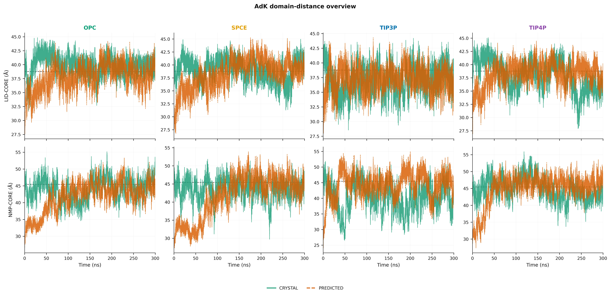
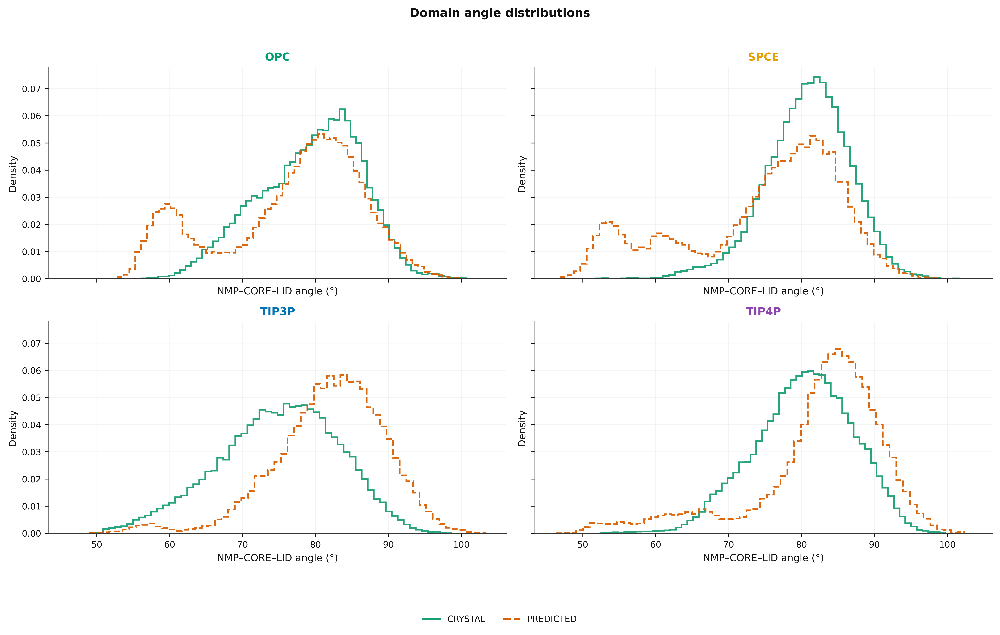
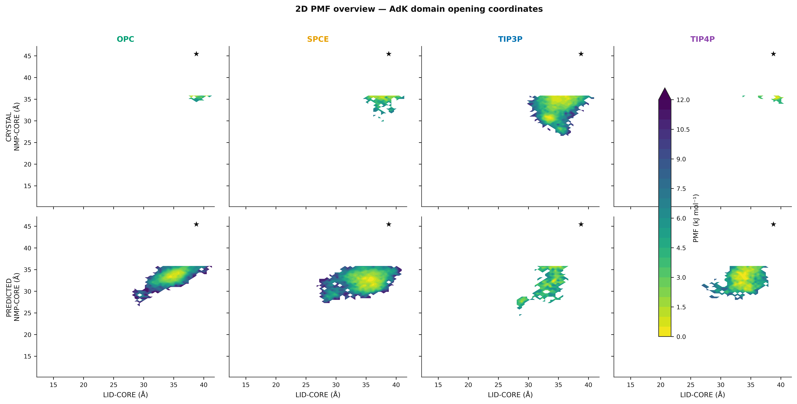
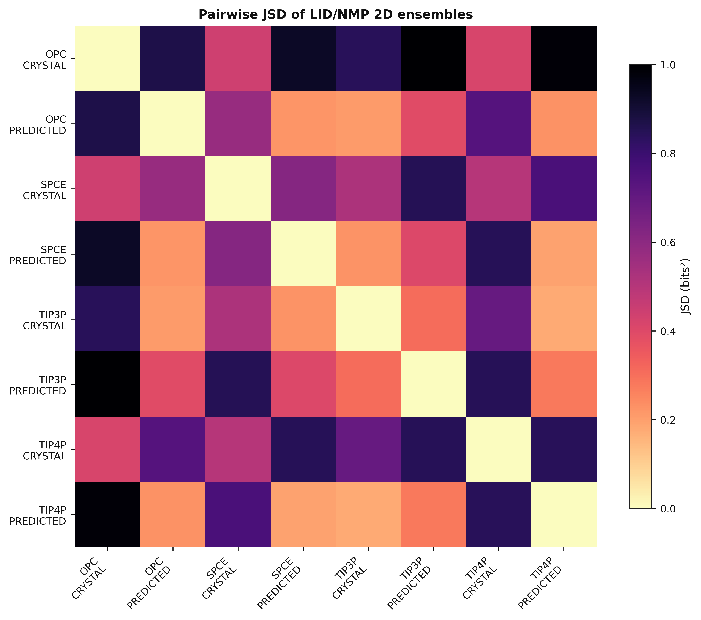
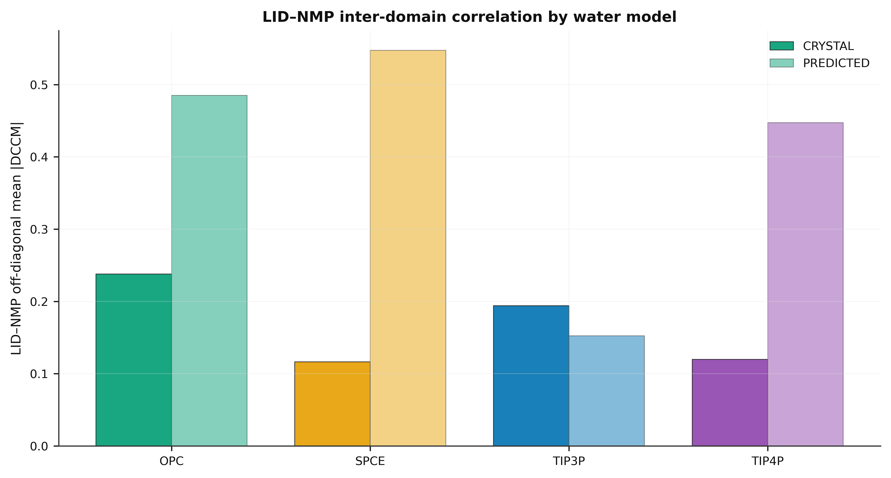

# Water-model and starting-structure effects on 4AKE dynamics

**A visual analysis of eight 300 ns molecular-dynamics trajectories of adenylate kinase (4AKE).** Four explicit-water models (OPC, SPC/E, TIP3P and TIP4P) were each run from a crystal-derived and a predicted starting structure. The identity of the predicted structure and the simulation setup still need confirmation.

> **Status:** Figure-led results story. The figures describe these trajectories; they do not yet establish a general ranking of water models. Simulation input files, analysis scripts and independent replicate information are not present in this folder.

**Explore:** [Domain motion](#2-the-solvent-and-starting-structure-jointly-shape-domain-opening) · [Conformational landscapes](#3-the-sampled-conformational-landscapes-differ) · [Hydration context](#4-solvent-facing-readouts-suggest-possible-mechanisms) · [Evidence and limits](docs/EVIDENCE_AND_LIMITS.md)

## The question

Does changing the water model alter the domain motions sampled by 4AKE, and does that depend on whether the simulation starts from the crystal or predicted structure?

## The visual story

### 1. The starting structure leaves a time-dependent signature

The predicted-start trajectories begin with larger deviations from the open reference in several conditions. The clearest early relaxation is in the NMP domain for OPC and SPC/E. The backbone and domain RMSD traces show why a single whole-trajectory average can hide this behavior.

**Figure 1.** Backbone, LID, NMP and core RMSD relative to the open reference. Columns are water models; green is crystal start and orange is predicted start. Source: [`tables/rmsd_summary.csv`](tables/rmsd_summary.csv) and the underlying time series, which are retained locally but omitted from the compact GitHub package.

### 2. The solvent and starting structure jointly shape domain opening

LID–core and NMP–core distances do not shift in one uniform direction. For example, OPC crystal has a mean NMP–core distance of **44.09 Å** versus **41.73 Å** for OPC predicted; TIP3P reverses that ordering (**40.27 Å** crystal versus **44.36 Å** predicted). The angle distributions tell a similar condition-dependent story.

**Figures 2–3.** Domain distance time series and NMP–core–LID angle distributions. Values and labels: [`domain_distance_summary.csv`](tables/domain_distance_summary.csv), [`domain_angle_summary.csv`](tables/domain_angle_summary.csv). The separation of curves is descriptive evidence from individual trajectories, not a replicate-level uncertainty estimate.

### 3. The sampled conformational landscapes differ

The two-dimensional LID/NMP maps show distinct occupied regions across the eight conditions. A Jensen–Shannon divergence analysis of the same domain coordinates gives lower crystal-versus-predicted divergence for TIP3P than for the other three water models in this dataset. This is a **within-dataset comparison**, not evidence that TIP3P is generally the most accurate model. The existing bootstrap intervals need review because trajectory frames are correlated.

**Figures 4–5.** Domain-coordinate landscape and pairwise Jensen–Shannon divergence. See [`docs/EVIDENCE_AND_LIMITS.md`](docs/EVIDENCE_AND_LIMITS.md) for interpretation and analysis cautions.

### 4. Solvent-facing readouts suggest possible mechanisms

Water-bridge counts and domain-motion correlations vary by condition. They offer hypotheses about coupling between hydration and motion, but the present results do not prove that individual waters cause particular conformational changes.

**Figures 6–7.** Mean bridge-water counts and off-diagonal LID/NMP dynamic cross-correlation. Summaries: [`water_bridge_summary.csv`](tables/water_bridge_summary.csv), [`dccm_network_summary.csv`](tables/dccm_network_summary.csv). Definitions and cutoffs must be recovered before manuscript use.

## What this dataset supports

The strongest defensible conclusion is that **water model and initial structure jointly affect the domain conformations sampled in these eight 4AKE trajectories**. The differences are visible across distance traces, angle distributions, conformational maps, and hydration-related readouts. The data do not yet support a universal water-model ranking, experimental accuracy claim, or causal hydration mechanism.

## Repository map

- [`docs/EVIDENCE_AND_LIMITS.md`](docs/EVIDENCE_AND_LIMITS.md): claim-by-claim evidence, figure selection, and known analysis issues.
- [`docs/PREPRINT_DRAFT.md`](docs/PREPRINT_DRAFT.md): provisional title, abstract and manuscript outline.
- [`docs/METHODS_TO_RECOVER.md`](docs/METHODS_TO_RECOVER.md): exact information needed for a reproducible preprint.
- [`figures/`](figures/): selected visual-story panels. The local results folder contains additional exploratory figures.
- [`tables/`](tables/): compact summary tables for the displayed comparisons.

## Publication status

The visual story stands on its own. If we later pursue a preprint, it should wait for the simulation protocol, predicted-structure provenance, trajectory/replicate accounting, and checks of statistical uncertainty and water-diffusion analysis. See the optional [preprint draft](docs/PREPRINT_DRAFT.md) and [methods checklist](docs/METHODS_TO_RECOVER.md).
